  
  

### 👋 Про мене

Я **Ігор** — frontend-розробник. Базу з програмування отримав на курсах **GoIT**: HTML, CSS, **JavaScript** і **React**.

Зараз працюю у форматі **вайб-кодингу** — створюю проєкти разом із нейромережами. Знання основ допомагають мені розуміти, що саме пише AI, перевіряти й виправляти код, тому робота йде швидше, а результат — під контролем.

**Що це означає для вас:**

- ⚡ **Швидко.** AI бере на себе рутину, я — архітектуру, перевірку й доведення до результату.
- 🧠 **Зрозуміло.** Я не просто копіюю згенерований код: можу пояснити, як він працює, і доробити його.
- 🌐 **Frontend.** Сайти й інтерфейси на JavaScript, React, Astro.

🇬🇧 In English

I'm **Ihor**, a frontend developer. I learned the fundamentals at **GoIT** courses: HTML, CSS, **JavaScript** and **React**.

These days I build with **vibe coding**, working together with AI models. Knowing the basics lets me understand what the AI writes, review and fix it, so projects move faster and stay under control.

- ⚡ **Fast.** AI handles the routine; I handle structure, review and getting it done.
- 🧠 **Clear.** I don't just paste generated code: I can explain how it works and extend it.
- 🌐 **Frontend.** Websites and interfaces with JavaScript, React, Astro.

### 🧰 Tech I use

  

### 📊 Stats

  

  <picture>
    <source media="(prefers-color-scheme: dark)" srcset="https://raw.githubusercontent.com/isteppanenko/isteppanenko/output/snake-dark.svg">
    
  </picture>

